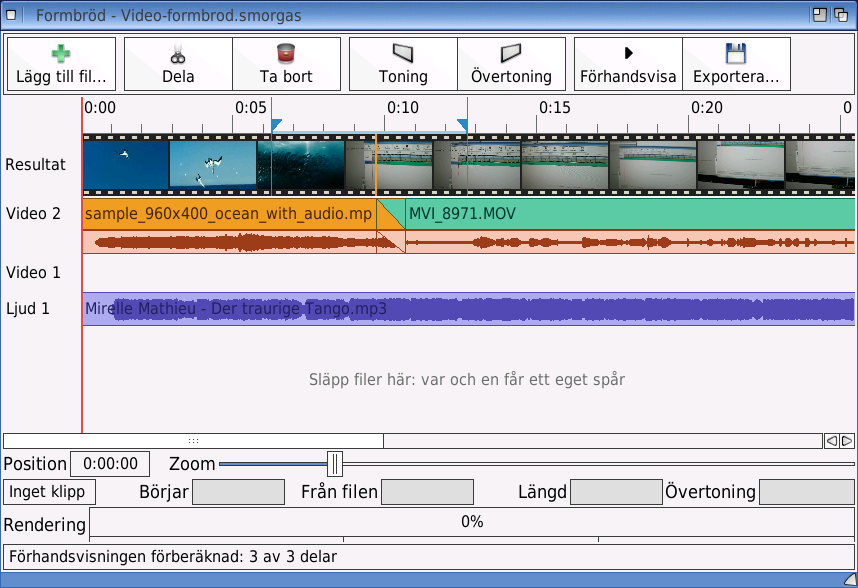

Formbröd is an all new AmigaOS native video editor.

 
  

    
  

 

I've had this idea for ages, and have sooo many started skeletons and scribbles in notebooks on what it should look like, and
how it would behave. It should of course have ARexx port, ReAction GUI, not rely on any thirdparty commandline tools, and foremost -- it should be easy to use and stable. And, here we are, finally done in 2026. Formbrod -- the video editor for AmigaOS 4!

 
  

    
  

 

Once you start it (it might take a while on slower machines since the binary is kind of large because ffmpeg is statically linked in) you can drag and drop video files on it, you can add images and soudn files. Each added files end up on its own track. If you want to shorten clips you simply drag in either corner. You can also drag clips around and change order.

It has a preview which should be relatively quick, but the quality might be worse. When exporting you should get better quality though it'll take a bit longer.

## Made mostly by AI
I've instructed Claude on how I wanted the program to woirk, and it has worked remarkably well. Within a few days I had a working version that could add clips and export and stuff. The code is available on [github/jaokim/Formbrod](https://github.com/jaokim/Formbrod/tree/main) and I've got some more stuff in the pipeline; adding effects, doing remote ffmpeg processing and more. If anyone has any feature -- please add them as issues or just get in touch with me and we'll make it happen. I also gladly take pull requests if you, or your AI agent has suggestions. The code needs some cleaning up of course.

It should be available on os4depot, just search for Formbrod. Happy VJ-ing!

